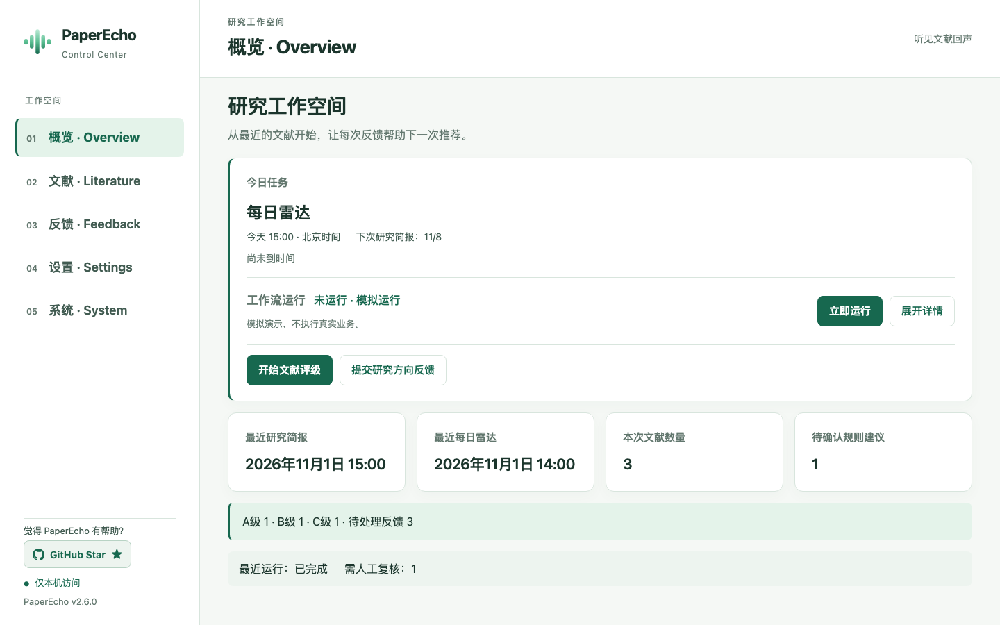

# PaperEcho

一个面向多学科研究的文献工作流：持续发现、筛选和整理新文献，并按需交付到 Zotero 或本地报告。

[快速开始](#快速开始) | [v2.6 更新](#更新内容) | [目录结构](#目录结构) | [English](#english-version)

## 这是什么

> **听见文献回声，找到值得追随的研究线索。**

新的文献不断出现，重要的不只是收集得更多，还要从持续更新的信息中，及时发现与自己研究相关的变化。

PaperEcho 是一套面向长期科研工作的文献追踪与整理工具。它持续获取新文献，完成去重、筛选、分级和整理，再将结果写入 Zotero 或生成本地报告，让值得关注的研究不被信息流淹没。

你可以选择 Zotero Desktop、Zotero Web API，或者完全脱离 Zotero 的 Standalone Local 路径；也可以根据研究方向组合 OpenAlex、Semantic Scholar、PubMed、Europe PMC、Crossref、RSS 或本地数据。

PaperEcho 不替代研究者作出判断。它负责整理不断传来的文献回声，把更多时间留给阅读、思考，以及下一步研究。

## 更新内容

**PaperEcho v2.6** 将配置、手动运行和结果回看进一步衔接到本地 Control Center，让发现文献、判断相关性和整理反馈能够在同一个工作台中完成。桌面版提供 macOS Apple Silicon（ARM64）DMG 和 Windows x64 Setup.exe；Windows 采用用户级安装，可以选择程序安装目录。安装后打开 PaperEcho，即可在独立应用窗口中使用工作台。



_工作台界面示意，使用隔离示例数据；正式使用时读取当前工作空间。_

- **运行从概览开始。** 配置好 Zotero Desktop 或 Web 路径后，可以点击「立即运行」启动现有文献流程，无需 Codex 或 Agent。运行详情在概览内展开，展示实际状态、阶段、耗时和已生成的产物；刷新页面读取已有状态，不会因此重新发起任务。原有文献评级和研究方向反馈入口继续保留。
- **自动化按研究节奏安排。** 每日雷达、研究简报间隔和撤稿检测集中到「自动化」页面。研究简报默认每 7 天运行，自动执行时间默认北京时间 15:00，均可修改。Desktop / Web 安装版接入系统任务注册、更新和注销；注册成功后，由系统任务调用无界面入口，不要求工作台持续打开。
- **AI 配置放在同一处。** 智能翻译与自适应学习共用服务地址、API Key 和模型配置，两个功能仍可分别开启或关闭。可以主动测试连接，查看配置是否能够调用模型；测试会发送极短请求，可能产生少量费用。密钥仍独立管理，不写入非敏感应用配置。
- **配置问题可以直接定位。** 系统页面集中展示需要处理的配置问题，并提供对应设置入口。保存成功后自动重新检查，已解决的问题从清单中移除。工作台的卡片、控件和操作区也统一调整了间距与对齐，优先照顾桌面横屏使用。
- **人工复核有明确边界。** 一致或相邻的 A/B/C 评级可自动采用，D→C 可自动救回；D→A/B、A/B/C→D、A↔C 等需要人工判断的结果由用户直接确认 A/B/C/D。常规反馈与人工复核分开处理，人工决定立即保存，但点击评级不会即时修改 Zotero。
- **完成后仍能回看和改评。** 常规反馈与人工复核的已处理文献保留在当前审阅集合中，刷新不会清空，新的有效工作流替换当前集合后再更新。全部复核完成时保留文献卡片，概览待办正确归零。
- **通知按研究节奏分配。** 每日雷达和研究简报可以分别选择邮箱、QQ、微信（WxPusher）、飞书和企业微信群机器人。工作台集中管理渠道配置、凭据状态、发送测试和最近结果；关闭渠道保留原配置，便于以后重新启用。通知概况仍依据本轮 A/B/C 文献的原始标题与等级生成，不声称读过摘要或全文；通知恢复沿用既有结果，不重跑文献处理。

浏览器工作台另有独立启动和停止入口，与桌面版在同一设备、同一系统用户、同一工作空间下共用配置与数据。它仍需要本地后端和相应运行时，不能只靠双击静态 HTML 完成业务。Windows 浏览器入口的无黑框、图标及停止重启行为仍待实机确认。入口说明见 [浏览器工作台启动说明](desktop/browser-workbench/ICON-ENTRY.md)。

Desktop、Web、Local 三条路径和 XLSX / DOCX 兼容入口继续保留。概览手动运行及系统定时入口目前用于 Desktop / Web，Local 沿用原有运行入口。macOS 系统任务注册目前要求主机时区为 `Asia/Shanghai`；新 Windows 安装包的原生运行与定时触发仍需实机确认。手动运行需要本地后端保持运行；桌面版的「登录时启动 PaperEcho」默认关闭，可自主设置，与系统定时任务分别管理。

非敏感应用配置保存在当前工作空间的 `config/paperecho.config.json`，密钥仍独立管理。中文标题与期刊来源在文献页、反馈、人工复核和 XLSX 间保持一致，RSS 订阅名称不再冒充期刊名。规则建议仍须通过正式写入与核验才能显示为已接受。

详细使用与边界见 [Control Center 说明](docs/control-center.md) 和 [配置指南](config/README.md)。PaperEcho 不提供 PDF 下载、全文阅读或全文内容总结。

## 核心特色

| 特色 | 说明 |
| --- | --- |
| Zotero Desktop | 继续使用本机 Zotero 文献库，通过 CLI 完成文献写入和整理。 |
| Zotero Web API | 连接 Zotero 云端文献库，无需保持桌面客户端运行。 |
| Standalone Local | 完全脱离 Zotero，通过本地文件完成文献处理和报告交付。 |
| 桌面与浏览器工作台 | 使用桌面应用或独立浏览器入口，在同一工作空间中管理配置、文献和反馈。 |
| 概览手动运行 | Desktop / Web 路径可从概览启动完整流程，就地查看运行状态、耗时和产物。 |
| 自主定时调度 | Desktop / Web 安装版可按配置注册系统任务；研究简报到期时运行简报，否则按设置运行每日雷达。 |
| 每日雷达 | 每天轻量发现新文献和重要研究线索；正式 Zotero 入库仍由研究简报流程统一完成。 |
| 多源文献发现 | 根据研究领域组合 OpenAlex、Semantic Scholar、PubMed、Europe PMC、Crossref、RSS 或本地数据，通过多源补充和统一去重降低单一来源漏召回的影响。 |
| 自动去重与分级 | 识别重复文献，完成 A/B/C/D 分级，把需要判断的内容留给研究者。 |
| Zotero 写回 | Desktop 和 Web 路径支持集合整理、批量写入和标题翻译回填。 |
| 本地独立交付 | Local 路径使用 JSON/JSONL 输入，在本地完成处理并生成报告。 |
| 智能翻译与自适应学习 | 共用 AI 服务配置，将标题翻译、文章反馈和长期筛选标准用于文献整理与后续筛选。 |
| 文献状态监测 | 持续关注已入库文献的撤稿、勘误等公开状态变化，并以保守方式提醒和整理。 |
| 任务恢复 | 长流程中断或超时后保留已确认进度，恢复时核对实际状态，减少重复写入和误操作。 |
| 报告与多渠道通知 | 生成研究简报和到期月报；按需通过邮箱、QQ、微信、飞书或企业微信群机器人发送每日雷达 / 研究简报概况，失败告警按独立配置启用。 |
| 自动维护 | 定期清理到期运行产物，同时保护长期配置、反馈和正式报告。 |

界面中的「研究简报」沿用既有报告与配置格式，`周报.xlsx` 等文件名不会因功能名称调整而改变。

## Skills

| Skill | 作用 | 一句话说明 |
| --- | --- | --- |
| `paperecho-workflow` | 共享能力 | 为三条路径提供文献发现、筛选、报告、通知和定期维护。 |
| `paperecho-zotero-desktop` | Zotero Desktop | 适合继续使用本机 Zotero 文献库的用户，通过 CLI 执行读写。 |
| `paperecho-zotero-web` | Zotero Web API | 适合使用 Zotero 云端文献库、无需保持桌面客户端运行的用户。 |
| `paperecho-local` | Standalone Local | 适合不使用 Zotero、希望通过本地文件完成全部处理和交付的用户。 |
| `paperecho-update` | 安全更新 | 检查并部署官方 stable 源码更新，同时保护配置、状态和用户输出。 |

如果通过 Codex 使用 PaperEcho，可选择与你的使用方式对应的 Skill。桌面和浏览器工作台可直接使用，无需 Codex 或 Agent。

## 目录结构

```text
├── README.md
├── LICENSE
├── AGENTS.md
├── .env.example
├── package.json
├── package-lock.json
├── config/
│   ├── paperecho.config.example.json
│   ├── rss_sources.json
│   ├── pubmed_pmc_search.json
│   ├── source_selection.json
│   ├── review-workflow-rules.json
│   ├── title_translation.config.json
│   ├── preference_learning.config.json
│   └── README.md
├── docs/
│   ├── configuration.md
│   ├── paperecho-setup-template.md
│   ├── contract-workflow.md
│   ├── contract-writeback.md
│   ├── contract-export.md
│   └── ...
├── skills/
│   ├── paperecho-workflow/
│   ├── paperecho-zotero-desktop/
│   │   └── scripts/run.mjs
│   ├── paperecho-zotero-web/
│   │   └── scripts/run.mjs
│   ├── paperecho-local/
│   │   └── scripts/run.mjs
│   └── paperecho-update/
│       └── scripts/update.mjs
├── desktop/
│   ├── electron-poc/
│   └── browser-workbench/
├── tests/
│   ├── full_workflow_benchmark/
│   └── helpers/
└── workflow/
    ├── tests/
    └── tools/
        ├── runner/
        │   ├── main.mjs
        │   ├── config_loader.mjs
        │   ├── preflight.mjs
        │   └── result_validation.mjs
        ├── stage0/main.mjs
        ├── local/main.mjs
        ├── stage1/
        ├── stage2/
        ├── stage3/
        ├── stage4/
        ├── stage5/
        ├── maintenance/
        └── lib/
```

## 快速开始

桌面用户可在 [GitHub Releases](https://github.com/Chip-G0202/PaperEcho/releases) 的对应版本附件中选择安装包：

- **macOS Apple Silicon（ARM64）**：打开 DMG，将 `PaperEcho.app` 拖入“应用程序”后启动。
- **Windows x64**：运行 `Setup.exe`，按向导选择程序安装目录，安装后启动 PaperEcho。
- **首次使用**：按配置向导选择运行路径、文献源、AI 服务及通知方式。已有工作空间继续读取原配置，不必重新创建。

请确认附件属于 v2.6；若该版本安装包尚未显示，请等待附件上传。`Source code` ZIP 是源码，不是桌面安装包。安装包未做 Apple 公证或 Windows 代码签名，可能出现系统来源提示；请核对项目仓库及 `SHA256SUMS.txt`，不需要全局关闭系统安全功能。

浏览器工作台使用单独的启动文件夹，具体依赖和启动、停止方式见 [浏览器工作台启动说明](desktop/browser-workbench/ICON-ENTRY.md)。不要把静态 HTML 预览当作完整业务入口。

以下步骤用于源码使用。

### 1. 准备环境

安装 Node.js >= 18、npm 和 PowerShell 7 (`pwsh`)。如果选择 Desktop 路径，还需要 Zotero Desktop；如果选择 Web 路径，需要 Zotero API key；Local 路径无需 Zotero。

### 2. 下载并安装依赖

以下命令固定获取 v2.6 源码：

```bash
git clone --branch v2.6 https://github.com/Chip-G0202/PaperEcho.git
cd PaperEcho
npm install
```

### 3. 创建本地配置

```powershell
Copy-Item config/paperecho.config.example.json config/paperecho.config.json
Copy-Item .env.example .env
node workflow/tools/maintenance/migrate_application_config.mjs --root .
```

复制的示例是兼容模板，迁移命令将其升级为当前配置格式。随后在 Control Center → Settings 或 `config/paperecho.config.json` 中选择 Desktop、Web 或 Local，并配置文献源、模型和通知渠道。密钥通过 Credentials、本机 `.env` 或外部环境维护，不写入主配置。研究方向与检索词的文件职责见 [配置指南](config/README.md)；长期筛选标准仍由 `screening_standards.md` 管理。

桌面安装版使用当前工作空间的数据目录，不应把源码目录的配置直接当作安装版配置覆盖。

### 4. 检查并运行

使用桌面工作台时，完成 Desktop 或 Web 配置后，可在概览点击「立即运行」。系统诊断会提示需要补充的配置；自动执行时间与手动运行分别管理。

通过 Codex 使用时，可选择对应的路径 Skill：

```text
使用 $paperecho-zotero-desktop，读取 config/paperecho.config.json，先检查配置，再运行完整流程。
使用 $paperecho-zotero-web，读取 config/paperecho.config.json，先检查配置，再运行完整流程。
使用 $paperecho-local，读取 config/paperecho.config.json，先检查配置，再运行本地流程。
```

也可以直接检查选定路径：

```powershell
node skills/paperecho-zotero-desktop/scripts/run.mjs --check --config config/paperecho.config.json
node skills/paperecho-zotero-web/scripts/run.mjs --check --config config/paperecho.config.json
node skills/paperecho-local/scripts/run.mjs --check --config config/paperecho.config.json
```

检查通过后，将所选命令中的 `--check` 改为 `--run`。

检查官方 stable 源码更新可使用 `$paperecho-update`，或运行：

```powershell
node skills/paperecho-update/scripts/update.mjs --check --json
```

只有明确需要部署且检查结果为 `safeToApply=true` 时，才将 `--check` 改为 `--apply`。此命令用于源码 / 工作流部署更新，不替代桌面安装包的安装与升级流程。

## 支持项目

如果 PaperEcho 帮你减少了重复筛选、整理和汇报的时间，可以请我喝杯咖啡，或随手赞赏支持后续维护。


## 付费安装配置与研究方向配置包

PaperEcho 本身采用 MIT License，你可以自由下载、修改和自部署。付费服务面向希望节省配置时间、快速落地三路径工作流，或希望为特定研究方向准备筛选配置的用户。

联系信息：g2269204031@163.com

### 定制安装配置服务

适合希望尽快把流程跑起来，但不想自行处理运行环境和配置细节的用户。

- Node.js、PowerShell、Zotero 与路径依赖检查
- Desktop、Web 或 Local 路径选择与统一配置
- `.env`、智能翻译、自适应学习和通知渠道配置
- 定时运行配置、运行前检查与首次运行排查

### 研究方向配置包

适合已有明确研究方向，希望获得一套可维护、可审计配置模板的用户。

- OpenAlex、PubMed/PMC、RSS 与本地数据源策略
- A/B/C/D 分级规则与边界设计
- `screening_standards.md` 初始结构
- 智能翻译、自适应学习、研究简报 / 月报和自动化运行清单

## 免责声明

本项目用于文献检索、信息整理、研究筛选与学术写作辅助，不替代专业研究判断、同行评议或对原始文献的核查。

自动分级、翻译和 AI 生成内容仅供参考。涉及医学、法律、工程安全或其他高风险领域时，不应将 PaperEcho 的输出直接作为诊断、决策或操作依据。

## License

MIT License. See [LICENSE](LICENSE).

---

# English Version

# PaperEcho

A multidisciplinary literature workflow for continuously discovering, screening, and organizing research, with delivery to Zotero or local reports.

[Quick Start](#quick-start) | [v2.6 Update](#update) | [Support](#support-the-project) | [License](#license-1)

## What is this?

> **Hear the echoes of research. Find the signals worth following.**

New papers arrive constantly. The challenge is not simply collecting more of them, but noticing which changes matter to your research.

PaperEcho is a literature tracking and organization tool for long-term research. It continuously collects new literature, removes duplicates, screens and grades results, then writes them to Zotero or produces local reports so relevant work is less likely to disappear into the stream.

Choose Zotero Desktop, Zotero Web API, or the fully independent Standalone Local path. Depending on your field, combine OpenAlex, Semantic Scholar, PubMed, Europe PMC, Crossref, RSS, or local data.

PaperEcho does not make research judgments for you. It handles the recurring organization work, leaving more time for reading, thinking, and deciding what to study next.

## Update

**PaperEcho v2.6** connects configuration, manual execution, and result review in the local Control Center, bringing literature discovery, relevance decisions, and feedback into the same workbench. Desktop packages target macOS Apple Silicon (ARM64) through a DMG and Windows x64 through a Setup.exe. Windows uses a per-user installer with a selectable installation directory. After installation, open PaperEcho to use the workbench in its own application window.

- **Start a run from Overview.** After configuring Zotero Desktop or Web, use “Run now” to start the existing literature workflow without Codex or an Agent. Details expand within Overview, showing actual status, stages, elapsed time, and generated outputs. Reloading restores the existing state rather than starting another run. Literature rating and research-direction feedback remain available.
- **Schedule work around your research.** Daily Radar, Research Brief intervals, and retraction detection share one Automation page. Research Briefs default to every 7 days, with a configurable daily execution time that defaults to 15:00 Beijing time. Desktop / Web installations can register, update, and remove OS tasks. Once registration succeeds, the OS task calls the headless entry without requiring the workbench to remain open.
- **Configure AI services in one place.** Smart Translation and Adaptive Learning share the service URL, API key, and model settings while retaining independent feature switches. An optional connection test checks whether the configured model can be called; it sends a short request and may incur a small charge. Credentials remain separate from non-secret application settings.
- **Go directly to configuration problems.** System shows configuration issues that need attention and links to the relevant settings. Successful saves trigger another check, removing resolved issues from the list. Cards, controls, and action areas also use more consistent spacing and alignment, with desktop landscape layouts in mind.
- **Clear boundaries for human review.** Matching or adjacent A/B/C grades can be adopted automatically, as can D→C rescue. Conflicts such as D→A/B, A/B/C→D, and A↔C require a direct A/B/C/D decision. Regular feedback and manual review remain separate; decisions save immediately, while clicking a rating does not modify Zotero.
- **Completed reviews remain available.** Processed Feedback and Manual Review cards stay in the current review set across reloads, until a valid workflow replaces that set. Users can revisit and revise decisions after completion, while Overview correctly shows zero pending tasks.
- **Choose channels for each event.** Daily Radar and Research Briefs can independently use email, QQ, WeChat through WxPusher, Feishu, and WeCom group bots. Configure channels, inspect credential status, test sending, and view recent results in one place. Disabling a channel preserves its configuration. Overviews use original titles and grades from the current A/B/C literature, without claiming to read abstracts or full texts. Delivery recovery reuses saved results instead of rerunning literature processing.

The browser workbench has separate start and stop entries. On the same device, under the same system user and workspace, it shares configuration and data with the desktop application. It still requires a local backend and the appropriate runtime; a static HTML file alone cannot run the workflow. The Windows browser entry’s console-free startup, icons, and stop/restart behavior still require native verification. See the [browser workbench startup guide](desktop/browser-workbench/ICON-ENTRY.md).

Desktop, Web, Local, and the existing XLSX / DOCX compatibility paths remain available. Overview manual runs and OS scheduling currently support Desktop / Web; Local retains its existing entry. macOS task registration currently requires the host timezone to be `Asia/Shanghai`. Native behavior of the new Windows installer and scheduled execution still requires verification. Manual runs require the local backend to remain running. Desktop login startup is optional, disabled by default, and managed separately from OS scheduling.

Non-secret application settings live in the current workspace’s `config/paperecho.config.json`, with credentials managed separately. Translated titles and publication venues stay consistent across Literature, Feedback, Manual Review, and XLSX; RSS feed labels remain separate from journal names. Rule suggestions still require a verified write to the formal configuration before being marked accepted.

See the [Control Center guide](docs/control-center.md) and [configuration guide](config/README.md). PaperEcho does not download PDFs, read full texts, or summarize full-text content.

## Quick Start

Desktop users can choose the matching package from the version’s [GitHub Release](https://github.com/Chip-G0202/PaperEcho/releases):

- **macOS Apple Silicon (ARM64):** open the DMG, drag `PaperEcho.app` into Applications, and launch it.
- **Windows x64:** run Setup.exe, choose the installation directory, and launch PaperEcho.
- **First use:** follow the setup wizard to select the runtime path, literature sources, AI service, and notifications. Existing workspaces continue using their saved configuration.

Check that the attachment belongs to v2.6. If its installers are not listed yet, wait for the version’s attachments to be uploaded. A Source code ZIP is not a desktop installer. Packages are not Apple-notarized or Windows code-signed and may produce system warnings. Verify the repository and `SHA256SUMS.txt`; do not disable system-wide security protections.

The browser workbench uses a separate launcher folder. See the [browser workbench startup guide](desktop/browser-workbench/ICON-ENTRY.md) for dependencies and start/stop instructions. A static preview is not a complete business entry.

For source use:

1. Install Node.js 18+, npm, and PowerShell 7+. Desktop also requires Zotero Desktop; Web requires a Zotero API key; Local requires no Zotero installation.
2. Get the v2.6 source with `git clone --branch v2.6 https://github.com/Chip-G0202/PaperEcho.git`, enter the repository, and run `npm install`.
3. Copy `config/paperecho.config.example.json` to `config/paperecho.config.json` and `.env.example` to `.env`, then run `node workflow/tools/maintenance/migrate_application_config.mjs --root .` to upgrade the compatibility template. Use Settings or the main configuration file to choose a runtime path, literature sources, models, and notification channels. Keep credentials in Credentials, the local `.env`, or an external environment; keep long-term screening standards in `screening_standards.md`. Installed desktop applications use their selected workspace data directory; do not overwrite that configuration with source-tree files.
4. In the desktop workbench, configure Desktop or Web and use “Run now” from Overview. For Codex use, choose `$paperecho-zotero-desktop`, `$paperecho-zotero-web`, or `$paperecho-local`. Source users can also run the selected launcher with `--check`, then change it to `--run` after the check passes.

To check for an official stable source update, use `$paperecho-update` or run `node skills/paperecho-update/scripts/update.mjs --check --json`. Use `--apply` only after an explicit update request and a `safeToApply=true` result. This updates source/workflow deployments rather than replacing the desktop installer upgrade process.

## Support the Project

If PaperEcho saves you time, you can buy me a coffee or send a small appreciation to support continued maintenance.


## Paid Setup & Research Direction Packs

PaperEcho is available under the MIT License. Paid support is intended for users who want faster setup or a maintainable direction-specific configuration pack.

Contact: g2269204031@163.com

### Custom installation & setup

Runtime checks, Desktop/Web/Local configuration, secret setup, scheduled workflow configuration, pre-run checks, and first-run troubleshooting.

### Research direction configuration pack

OpenAlex, PubMed/PMC, RSS, and local-source strategy design, A/B/C/D screening rules, screening standards, Smart Translation, Adaptive Learning, and recurring Research Brief and monthly report configuration.

## Disclaimer

PaperEcho supports literature discovery, information organization, research screening, and academic writing. It does not replace professional judgment, peer review, or verification against original sources. Its output must not be used directly for medical, legal, engineering-safety, or other high-risk decisions.

## License

MIT License. See [LICENSE](LICENSE).
