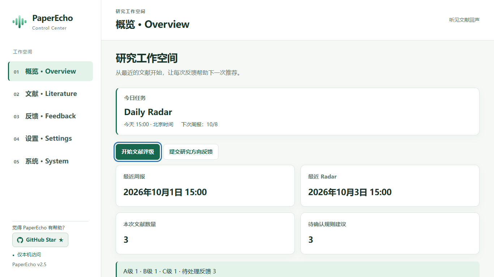

# PaperEcho

一个面向多学科研究的文献工作流：持续发现、筛选和整理新文献，并按需交付到 Zotero 或本地报告。

[快速开始](#快速开始) | [v2.5 更新](#更新内容) | [目录结构](#目录结构) | [English](#english-version)

## 这是什么

> **听见文献回声，找到值得追随的研究线索。**

新的文献不断出现，重要的不只是收集得更多，还要从持续更新的信息中，及时发现与自己研究相关的变化。

PaperEcho 是一套面向长期科研工作的文献追踪与整理工具。它持续获取新文献，完成去重、筛选、分级和整理，再将结果写入 Zotero 或生成本地报告，让值得关注的研究不被信息流淹没。

你可以选择 Zotero Desktop、Zotero Web API，或者完全脱离 Zotero 的 Standalone Local 路径；也可以根据研究方向组合 OpenAlex、Semantic Scholar、PubMed、Europe PMC、Crossref、RSS 或本地数据。

PaperEcho 不替代研究者作出判断。它负责整理不断传来的文献回声，把更多时间留给阅读、思考，以及下一步研究。

## 更新内容

**PaperEcho v2.5** 将多渠道通知、配置管理和人工审阅统一到本地 Control Center，让发现文献、判断相关性和接收研究动态衔接得更顺畅。Windows 双击 `PaperEcho.exe`，macOS 双击 `PaperEcho.app`；启动后会在默认浏览器打开当前工作区。源码使用仍需 Node.js 18+ 和项目依赖。



_工作台界面示意，图中状态为模拟数据；正式页面只读取当前工作区。_

- **通知按研究节奏分配。** Daily Radar 和周报可以分别选择邮箱、QQ、微信（WxPusher）、飞书和企业微信群机器人。工作台集中管理渠道配置、凭据状态、发送测试和最近结果；关闭渠道保留原配置，便于以后重新启用。
- **概况来自本轮文献。** 通知展示本轮数量、等级分布、研究概况和提醒，不逐篇罗列。概况仅依据本轮 A/B/C 文献的原始标题与等级生成，不声称读过摘要或全文；通知恢复沿用既有结果，不重跑文献处理。
- **人工复核有明确边界。** 一致或相邻的 A/B/C 评级可自动采用，D→C 可自动救回；D→A/B、A/B/C→D、A↔C 等需要人工判断的结果由用户直接确认 A/B/C/D。常规反馈与人工复核分开处理，人工决定立即保存，但点击评级不会即时修改 Zotero。
- **完成后仍能回看和改评。** 常规反馈与人工复核的已处理文献保留在当前审阅集合中，刷新不会清空，新的有效工作流替换当前集合后再更新。全部复核完成时保留文献卡片，概览待办正确归零；主要审阅入口已上移，进入概览即可开始操作。
- **配置和文献展示更一致。** 迁移后的非敏感应用配置统一保存在 `config/paperecho.config.json`，密钥仍独立管理，不必同步维护多份旧配置。中文标题与期刊来源在文献页、反馈、人工复核和 XLSX 间保持一致，RSS 订阅名称不再冒充期刊名。

Desktop、Web、Local 三条路径和 XLSX / DOCX 兼容入口继续保留。外部调度器调用 Desktop 或 Web 的 `--scheduled-daily` 后，由 PaperEcho 按计划时隙选择 Radar 或周报；本版本不自动注册系统定时任务，Local 不支持该入口。规则建议仍须通过正式写入与核验才能显示为已接受。

详细使用与边界见 [Control Center 说明](docs/control-center.md) 和 [配置指南](config/README.md)。PaperEcho 不提供 PDF 下载、全文阅读或全文内容总结。

## 核心特色

| 特色 | 说明 |
| --- | --- |
| Zotero Desktop | 继续使用本机 Zotero 文献库，通过 CLI 完成文献写入和整理。 |
| Zotero Web API | 连接 Zotero 云端文献库，无需保持桌面客户端运行。 |
| Standalone Local | 完全脱离 Zotero，通过本地文件完成文献处理和报告交付。 |
| 每日 Radar | 每天轻量发现新文献和重要研究线索；正式 Zotero 入库仍由周度流程统一完成。 |
| 多源文献发现 | 根据研究领域组合 OpenAlex、Semantic Scholar、PubMed、Europe PMC、Crossref、RSS 或本地数据，通过多源补充和统一去重降低单一来源漏召回的影响。 |
| 自动去重与分级 | 识别重复文献，完成 A/B/C/D 分级，把需要判断的内容留给研究者。 |
| Zotero 写回 | Desktop 和 Web 路径支持集合整理、批量写入和标题翻译回填。 |
| 本地独立交付 | Local 路径使用 JSON/JSONL 输入，在本地完成处理并生成报告。 |
| 反馈持续学习 | 将文章反馈和长期筛选标准用于后续筛选，减少重复调整。 |
| 文献状态监测 | 持续关注已入库文献的撤稿、勘误等公开状态变化，并以保守方式提醒和整理。 |
| 任务恢复 | 长流程中断或超时后保留已确认进度，恢复时核对实际状态，减少重复写入和误操作。 |
| 报告与多渠道通知 | 生成周报和到期月报；按需通过邮箱、QQ、微信、飞书或企业微信群机器人发送 Radar / 周报概况，失败告警按独立配置启用。 |
| 自动维护 | 定期清理到期运行产物，同时保护长期配置、反馈和正式报告。 |

## Skills

| Skill | 作用 | 一句话说明 |
| --- | --- | --- |
| `paperecho-workflow` | 共享能力 | 为三条路径提供文献发现、筛选、报告、通知和定期维护。 |
| `paperecho-zotero-desktop` | Zotero Desktop | 适合继续使用本机 Zotero 文献库的用户，通过 CLI 执行读写。 |
| `paperecho-zotero-web` | Zotero Web API | 适合使用 Zotero 云端文献库、无需保持桌面客户端运行的用户。 |
| `paperecho-local` | Standalone Local | 适合不使用 Zotero、希望通过本地文件完成全部处理和交付的用户。 |
| `paperecho-update` | 安全更新 | 检查并部署官方最新 stable release，同时保护配置、状态和用户输出。 |

在 Codex 中选择与你的使用方式对应的 Skill，即可进入相应路径。

## 目录结构

```text
├── README.md
├── LICENSE
├── AGENTS.md
├── .env.example
├── package.json
├── package-lock.json
├── config/
│   ├── paperecho.config.example.json
│   ├── rss_sources.json
│   ├── pubmed_pmc_search.json
│   ├── source_selection.json
│   ├── review-workflow-rules.json
│   ├── title_translation.config.json
│   ├── preference_learning.config.json
│   └── README.md
├── docs/
│   ├── configuration.md
│   ├── paperecho-setup-template.md
│   ├── contract-workflow.md
│   ├── contract-writeback.md
│   ├── contract-export.md
│   └── ...
├── skills/
│   ├── paperecho-workflow/
│   ├── paperecho-zotero-desktop/
│   │   └── scripts/run.mjs
│   ├── paperecho-zotero-web/
│   │   └── scripts/run.mjs
│   ├── paperecho-local/
│   │   └── scripts/run.mjs
│   └── paperecho-update/
│       └── scripts/update.mjs
├── tests/
│   ├── full_workflow_benchmark/
│   └── helpers/
└── workflow/
    ├── tests/
    └── tools/
        ├── runner/
        │   ├── main.mjs
        │   ├── config_loader.mjs
        │   ├── preflight.mjs
        │   └── result_validation.mjs
        ├── stage0/main.mjs
        ├── local/main.mjs
        ├── stage1/
        ├── stage2/
        ├── stage3/
        ├── stage4/
        ├── stage5/
        ├── maintenance/
        └── lib/
```

## 快速开始

### 1. 准备环境

安装 Node.js >= 18、npm 和 PowerShell 7 (`pwsh`)。如果选择 Desktop 路径，还需要 Zotero Desktop；如果选择 Web 路径，需要 Zotero API key；Local 路径无需 Zotero。

### 2. 下载并安装依赖

以下命令固定安装已发布的 v2.5：

```bash
git clone --branch v2.5 https://github.com/Chip-G0202/PaperEcho.git
cd PaperEcho
npm install
```

### 3. 创建本地配置

```powershell
Copy-Item config/paperecho.config.example.json config/paperecho.config.json
Copy-Item .env.example .env
node workflow/tools/maintenance/migrate_application_config.mjs --root .
```

复制的示例是兼容模板，迁移命令将其升级为当前配置格式。随后在 Control Center → Settings 或 `config/paperecho.config.json` 中选择 Desktop、Web 或 Local，并配置文献源、模型和通知渠道。密钥通过 Credentials、本机 `.env` 或外部环境维护，不写入主配置。研究方向与检索词的文件职责见 [配置指南](config/README.md)；长期筛选标准仍由 `screening_standards.md` 管理。

### 4. 检查并运行

在 Codex 中使用对应的路径 Skill：

```text
使用 $paperecho-zotero-desktop，读取 config/paperecho.config.json，先检查配置，再运行完整流程。
使用 $paperecho-zotero-web，读取 config/paperecho.config.json，先检查配置，再运行完整流程。
使用 $paperecho-local，读取 config/paperecho.config.json，先检查配置，再运行本地流程。
```

也可以直接检查选定路径：

```powershell
node skills/paperecho-zotero-desktop/scripts/run.mjs --check --config config/paperecho.config.json
node skills/paperecho-zotero-web/scripts/run.mjs --check --config config/paperecho.config.json
node skills/paperecho-local/scripts/run.mjs --check --config config/paperecho.config.json
```

检查通过后，将所选命令中的 `--check` 改为 `--run`。

检查官方 stable 更新可使用 `$paperecho-update`，或运行：

```powershell
node skills/paperecho-update/scripts/update.mjs --check --json
```

只有明确需要部署且检查结果为 `safeToApply=true` 时，才将 `--check` 改为 `--apply`。

## 支持项目

如果 PaperEcho 帮你减少了重复筛选、整理和汇报的时间，可以请我喝杯咖啡，或随手赞赏支持后续维护。


## 付费安装配置与研究方向配置包

PaperEcho 本身采用 MIT License，你可以自由下载、修改和自部署。付费服务面向希望节省配置时间、快速落地三路径工作流，或希望为特定研究方向准备筛选配置的用户。

联系信息：g2269204031@163.com

### 定制安装配置服务

适合希望尽快把流程跑起来，但不想自行处理运行环境和配置细节的用户。

- Node.js、PowerShell、Zotero 与路径依赖检查
- Desktop、Web 或 Local 路径选择与统一配置
- `.env`、标题翻译、偏好学习和通知渠道配置
- Codex 定时任务、运行前检查与首次运行排查

### 研究方向配置包

适合已有明确研究方向，希望获得一套可维护、可审计配置模板的用户。

- OpenAlex、PubMed/PMC、RSS 与本地数据源策略
- A/B/C/D 分级规则与边界设计
- `screening_standards.md` 初始结构
- 标题翻译、偏好学习、周报/月报和自动化运行清单

## 免责声明

本项目用于文献检索、信息整理、研究筛选与学术写作辅助，不替代专业研究判断、同行评议或对原始文献的核查。

自动分级、翻译和 AI 生成内容仅供参考。涉及医学、法律、工程安全或其他高风险领域时，不应将 PaperEcho 的输出直接作为诊断、决策或操作依据。

## License

MIT License. See [LICENSE](LICENSE).

---

# English Version

# PaperEcho

A multidisciplinary literature workflow for continuously discovering, screening, and organizing research, with delivery to Zotero or local reports.

[Quick Start](#quick-start) | [v2.5 Update](#update) | [Support](#support-the-project) | [License](#license-1)

## What is this?

> **Hear the echoes of research. Find the signals worth following.**

New papers arrive constantly. The challenge is not simply collecting more of them, but noticing which changes matter to your research.

PaperEcho is a literature tracking and organization tool for long-term research. It continuously collects new literature, removes duplicates, screens and grades results, then writes them to Zotero or produces local reports so relevant work is less likely to disappear into the stream.

Choose Zotero Desktop, Zotero Web API, or the fully independent Standalone Local path. Depending on your field, combine OpenAlex, Semantic Scholar, PubMed, Europe PMC, Crossref, RSS, or local data.

PaperEcho does not make research judgments for you. It handles the recurring organization work, leaving more time for reading, thinking, and deciding what to study next.

## Update

**PaperEcho v2.5** brings notification channels, configuration, and human review together in the local Control Center, connecting literature discovery with research decisions and updates. Open `PaperEcho.exe` on Windows or `PaperEcho.app` on macOS to launch the current workspace in your default browser. Source installations still require Node.js 18+ and project dependencies.

- **Choose channels for each event.** Daily Radar and Weekly can independently use email, QQ, WeChat through WxPusher, Feishu, and WeCom group bots. Configure channels, inspect credential status, test sending, and view recent results in one place. Disabling a channel preserves its configuration.
- **An overview grounded in the current run.** Notifications contain counts, grade distribution, a research overview, and alerts rather than individual paper lists. The overview uses only original titles and grades from the current A/B/C literature, without claiming to read abstracts or full texts. Delivery recovery reuses saved results instead of rerunning literature processing.
- **Clear boundaries for human review.** Matching or adjacent A/B/C grades can be adopted automatically, as can D→C rescue. Conflicts such as D→A/B, A/B/C→D, and A↔C require a direct A/B/C/D decision. Regular feedback and manual review remain separate; decisions save immediately, while clicking a rating does not modify Zotero.
- **Completed reviews remain available.** Processed Feedback and Manual Review cards stay in the current review set across reloads, until a valid workflow replaces that set. Users can revisit and revise decisions after completion, while Overview correctly shows zero pending tasks. Primary review actions are now near the top of Overview.
- **Consistent configuration and metadata.** Migrated non-secret settings use `config/paperecho.config.json`, with credentials managed separately. Translated titles and publication venues stay consistent across Literature, Feedback, Manual Review, and XLSX; RSS feed labels are kept separate from journal names.

Desktop, Web, Local, and the existing XLSX / DOCX compatibility paths remain available. An external scheduler can call `--scheduled-daily` for Desktop or Web; PaperEcho selects Radar or Weekly according to the planned slot. This version does not register an OS scheduler, and Local does not support this entry. Rule suggestions still require a verified write to the formal configuration before being marked accepted.

See the [Control Center guide](docs/control-center.md) and [configuration guide](config/README.md). PaperEcho does not download PDFs, read full texts, or summarize full-text content.

## Quick Start

1. Install Node.js 18+, npm, and PowerShell 7+. Desktop also requires Zotero Desktop; Web requires a Zotero API key; Local requires no Zotero installation.
2. Clone the published version with `git clone --branch v2.5 https://github.com/Chip-G0202/PaperEcho.git`, enter the repository, and run `npm install`.
3. Copy `config/paperecho.config.example.json` to `config/paperecho.config.json` and `.env.example` to `.env`, then run `node workflow/tools/maintenance/migrate_application_config.mjs --root .` to upgrade the compatibility template. Use Settings or the main configuration file to choose a runtime path, literature sources, models, and notification channels. Keep credentials in Credentials, the local `.env`, or an external environment; keep long-term screening standards in `screening_standards.md`.
4. Use `$paperecho-zotero-desktop`, `$paperecho-zotero-web`, or `$paperecho-local` in Codex. Run the selected launcher with `--check`, then change it to `--run` after the check passes.

To check for an official stable update, use `$paperecho-update` or run `node skills/paperecho-update/scripts/update.mjs --check --json`. Use `--apply` only after an explicit update request and a `safeToApply=true` result.

## Support the Project

If PaperEcho saves you time, you can buy me a coffee or send a small appreciation to support continued maintenance.


## Paid Setup & Research Direction Packs

PaperEcho is available under the MIT License. Paid support is intended for users who want faster setup or a maintainable direction-specific configuration pack.

Contact: g2269204031@163.com

### Custom installation & setup

Runtime checks, Desktop/Web/Local configuration, secret setup, scheduled Codex tasks, pre-run checks, and first-run troubleshooting.

### Research direction configuration pack

OpenAlex, PubMed/PMC, RSS, and local-source strategy design, A/B/C/D screening rules, screening standards, translation, feedback learning, and recurring report configuration.

## Disclaimer

PaperEcho supports literature discovery, information organization, research screening, and academic writing. It does not replace professional judgment, peer review, or verification against original sources. Its output must not be used directly for medical, legal, engineering-safety, or other high-risk decisions.

## License

MIT License. See [LICENSE](LICENSE).
